<p align="center">
  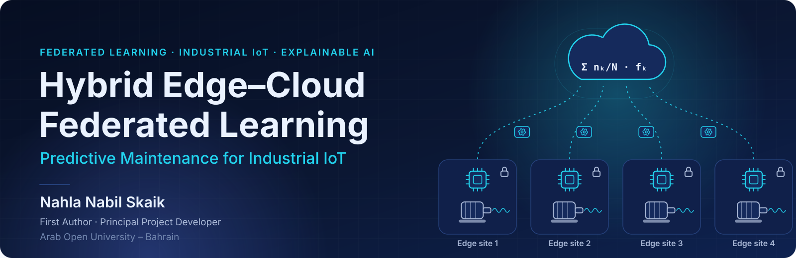
</p>

<p align="center">
  <a href="https://ieeexplore.ieee.org/document/11430844"></a>
  <a href="LICENSE"></a>
  
  
  
</p>

<h3 align="center">Hybrid Edge–Cloud Federated Learning Framework<br>for Predictive Maintenance in Industrial IoT</h3>

<p align="center">
  <b>Nahla Nabil Skaik</b> — First Author &amp; Principal Project Developer<br>
  Arab Open University – Bahrain<br><br>
  📄 <a href="https://ieeexplore.ieee.org/document/11430844"><b>Read the published paper on IEEE Xplore</b></a>
</p>

<p align="center">
  <a href="#-overview">Overview</a> ·
  <a href="#-architecture">Architecture</a> ·
  <a href="#-published-results">Results</a> ·
  <a href="#-shap-explainability">Explainability</a> ·
  <a href="#-getting-started">Get started</a> ·
  <a href="#-citation">Citation</a>
</p>

---

<details>
<summary><b>📑 Table of contents</b></summary>

1. [Overview](#-overview)
2. [Key features](#-key-features)
3. [Problem statement](#-problem-statement)
4. [Contributions](#-contributions)
5. [Architecture](#-architecture)
6. [Centralized vs federated learning](#-centralized-vs-federated-learning)
7. [Dataset and preprocessing](#-dataset-and-preprocessing)
8. [Methodology](#-methodology)
9. [Experimental workflow](#-experimental-workflow)
10. [Published results](#-published-results)
11. [Algorithm benchmarking](#-algorithm-benchmarking)
12. [Scalability](#-scalability)
13. [SHAP explainability](#-shap-explainability)
14. [Getting started](#-getting-started)
15. [Repository structure](#-repository-structure)
16. [Technology stack](#-technology-stack)
17. [Limitations](#-limitations)
18. [Roadmap and future research](#-roadmap-and-future-research)
19. [Citation](#-citation)
20. [Author and contact](#-author-and-contact)
21. [License and data credits](#-license-and-data-credits)

</details>

---

## 🔭 Overview

Predictive maintenance (PdM) uses sensor data, such as bearing vibration, to detect equipment degradation before it causes unplanned downtime. Most PdM pipelines send raw sensor data to one central server. That raises concerns about data sensitivity, network load and the very different (Non-IID) data produced at each industrial site.

This project presents a **hybrid edge–cloud federated learning framework** for bearing fault diagnosis, with its experiment notebook:

- 🏭 **Edge.** Each site trains a lightweight Random Forest on its own vibration features.
- ☁️ **Cloud.** A central server aggregates the edge models into a global model.
- 🧠 **Explainability.** SHAP shows which vibration features drive each fault classification.

The framework is evaluated on the **Case Western Reserve University (CWRU)** bearing benchmark, and the work is published on **[IEEE Xplore](https://ieeexplore.ieee.org/document/11430844)**.

<p align="center">
  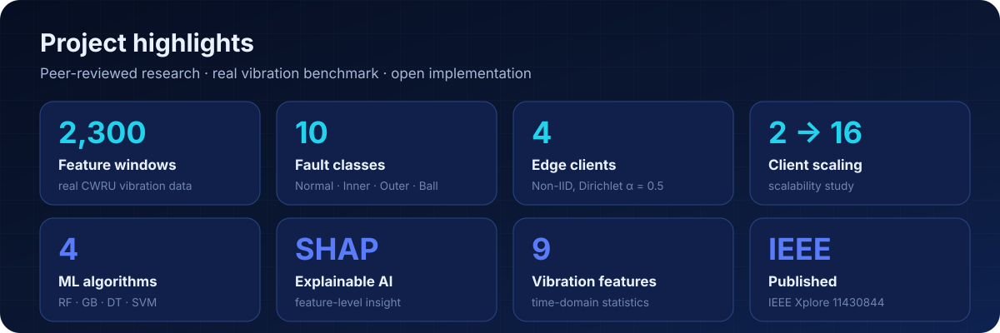
</p>

---

## ✨ Key features

| | Feature | Description |
|---|---|---|
| 🏗 | **Hybrid edge–cloud design** | Local training at edge clients, global aggregation in the cloud |
| 🔀 | **Non-IID simulation** | Client label distributions drawn from a Dirichlet distribution (α = 0.5) |
| 🌲 | **Lightweight edge models** | Random Forests (80 trees, depth 10) suited to resource-constrained devices |
| ⚖️ | **Centralized baseline** | Random Forest (150 trees, depth 12) trained on all training data |
| 🧪 | **Algorithm comparison** | Random Forest, Gradient Boosting, Decision Tree, SVM (RBF) |
| 📈 | **Scalability study** | 2, 4, 8 and 16 clients |
| 🧠 | **Explainable AI** | SHAP feature-importance analysis |
| 📊 | **Rich outputs** | Confusion matrices, ROC curves, feature importance, CSV metrics, saved models |

<p align="center">
  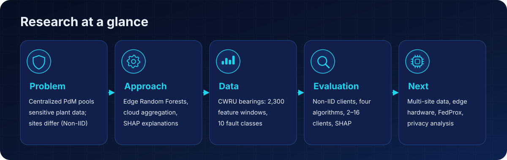
</p>

---

## 🎯 Problem statement

> Can industrial sites collaboratively train an accurate bearing-fault classifier without pooling their raw sensor data, while staying robust to heterogeneous data and interpretable for maintenance engineers?

| Industrial challenge | Why it matters |
|---|---|
| 🔒 **Data sensitivity** | Vibration logs reveal how equipment and production lines operate |
| 📡 **Network constraints** | Streaming high-rate sensor data from every machine is costly |
| 🏭 **Non-IID data** | Loads, machine ages and fault mixes differ from site to site |
| 🧭 **Interpretability** | Safety-critical maintenance decisions need clear explanations |

---

## 🏆 Contributions

As stated in the published paper:

1. A **hybrid edge–cloud federated learning architecture** for industrial predictive maintenance.
2. **SHAP explainability** integrated into the federated pipeline for transparent fault diagnosis.
3. An **evaluation on real CWRU bearing data** with Non-IID client distributions.
4. A **comparison of four classical algorithms** and a **scalability study** from 2 to 16 clients.
5. An **open-source implementation** for further research.

---

## 🏗 Architecture

<p align="center">
  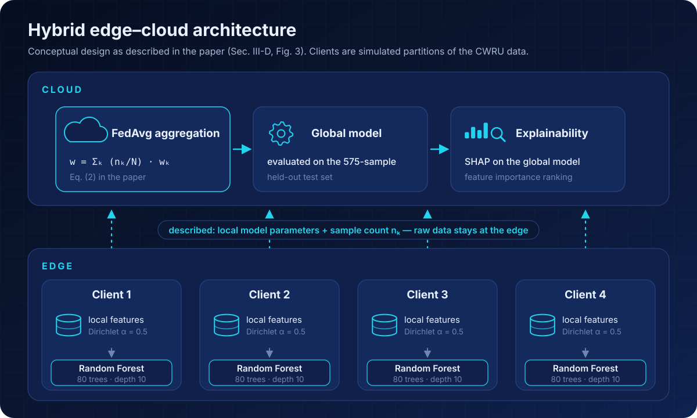
</p>

<sub>Conceptual design as described in the paper (Sec. III-D, Fig. 3). In the experiments, the clients are simulated partitions of the CWRU data on a single machine.</sub>

<details>
<summary><b>Diagram source (Mermaid)</b></summary>

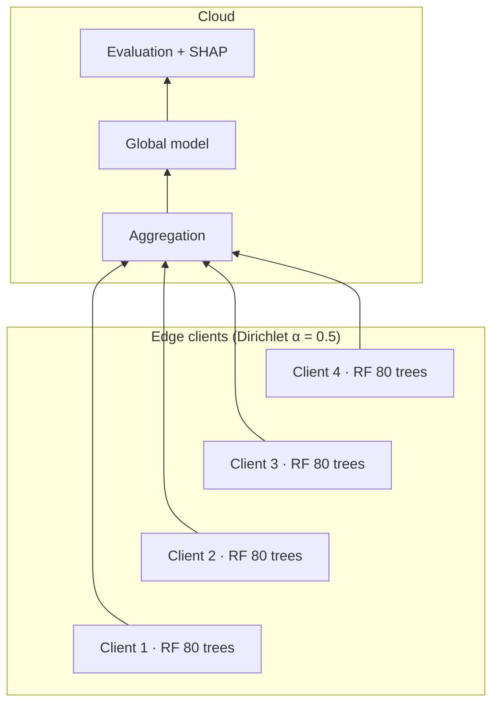

</details>

---

## ⚖ Centralized vs federated learning

<p align="center">
  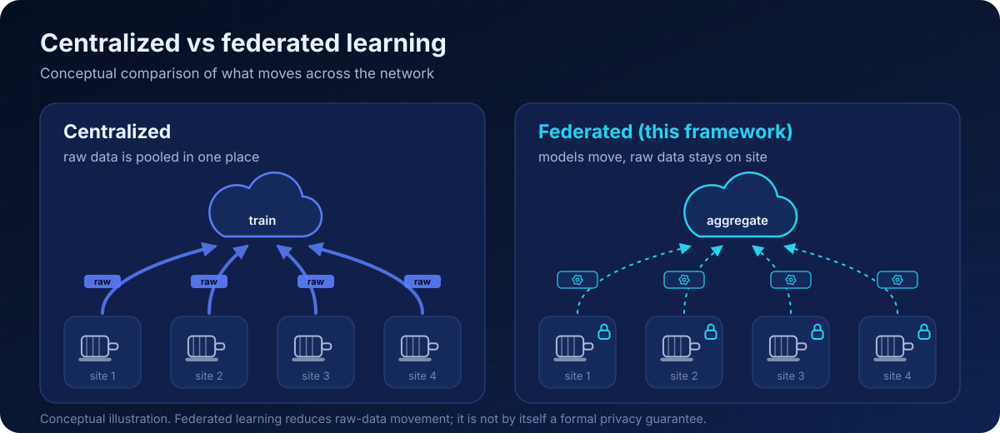
</p>

---

## 🗂 Dataset and preprocessing

<p align="center">
  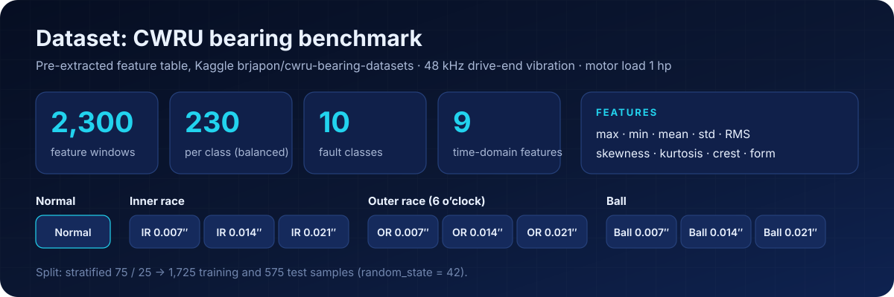
</p>

| Property | Value |
|---|---|
| **Source** | CWRU Bearing Data Center, via the Kaggle feature table [`brjapon/cwru-bearing-datasets`](https://www.kaggle.com/datasets/brjapon/cwru-bearing-datasets) (`feature_time_48k_2048_load_1.csv`) |
| **Signals** | Real drive-end vibration · 48 kHz · 2,048-point windows · motor load 1 hp |
| **Samples** | 2,300 windows · 10 classes · 230 per class (balanced) |
| **Features** | max · min · mean · standard deviation · RMS · skewness · kurtosis · crest factor · form factor |
| **Preprocessing** | Median imputation · label encoding (0–9) · z-score standardization · stratified 75/25 split (`random_state = 42`) |

| Class group | Labels |
|---|---|
| Normal | Normal |
| Inner race | IR 0.007″ · IR 0.014″ · IR 0.021″ |
| Outer race (6 o’clock) | OR 0.007″ · OR 0.014″ · OR 0.021″ |
| Ball | Ball 0.007″ · Ball 0.014″ · Ball 0.021″ |

---

## 🤝 Methodology

| Component | Configuration (as described in the paper) |
|---|---|
| **Edge clients** | 4 nodes · Non-IID label distributions from Dirichlet (α = 0.5) |
| **Local model** | Random Forest · 80 estimators · max depth 10 |
| **Cloud aggregation** | Sample-size-weighted aggregation, *w*<sub>global</sub> = Σ<sub>k</sub> (*n*<sub>k</sub>/*N*) · *w*<sub>k</sub> (paper Eq. 2) |
| **Centralized baseline** | Random Forest · 150 estimators · max depth 12 · all 1,725 training samples |
| **Evaluation** | 575 held-out test samples · accuracy, precision, recall, F1, AUC-ROC |
| **Explainability** | SHAP TreeExplainer on the global model |

---

## ⚙ Experimental workflow

<p align="center">
  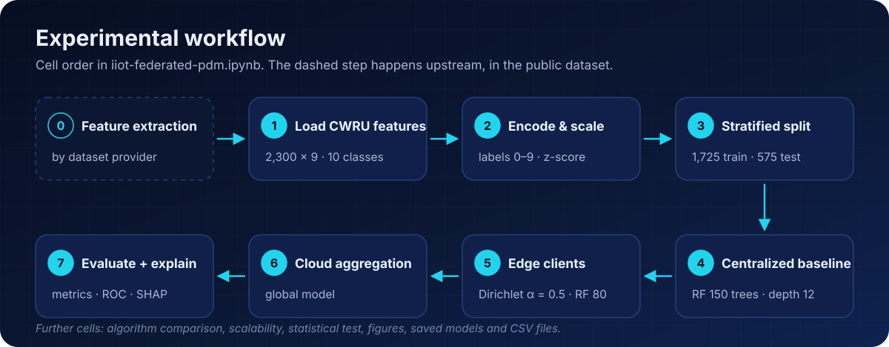
</p>

---

## 📈 Published results

Results as **reported in the published paper** (Table I) for a single stratified train/test split.

<p align="center">
  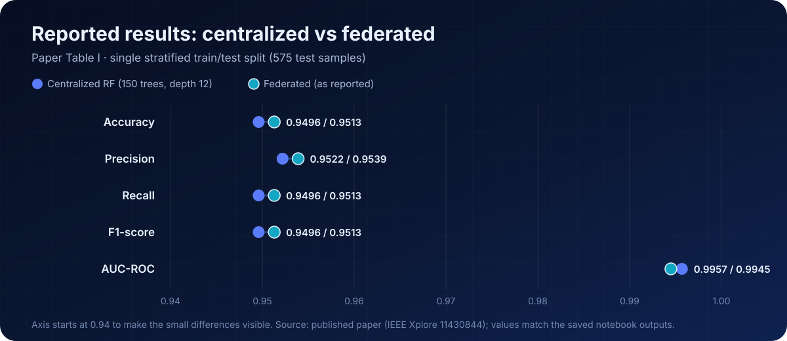
</p>

| Metric | Centralized | Federated (as reported) |
|---|:---:|:---:|
| Accuracy | 0.9496 | 0.9513 |
| Precision | 0.9522 | 0.9539 |
| Recall | 0.9496 | 0.9513 |
| F1-score | 0.9496 | 0.9513 |
| AUC-ROC | 0.9957 | 0.9945 |

<details>
<summary><b>🔍 Confusion matrices and ROC curves</b></summary>

<p align="center">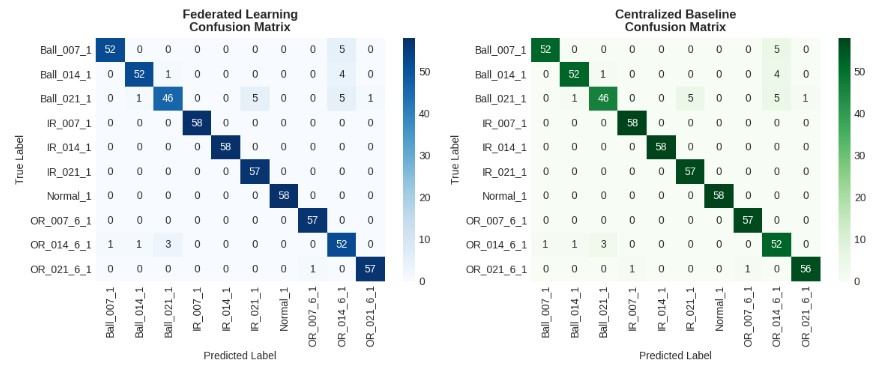</p>
<p align="center">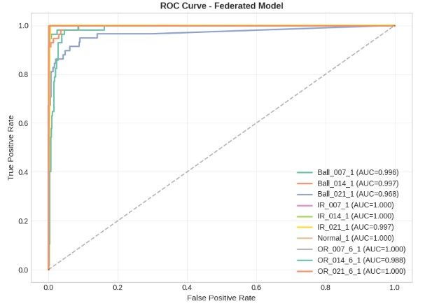</p>

</details>

---

## 🧪 Algorithm benchmarking

<p align="center">
  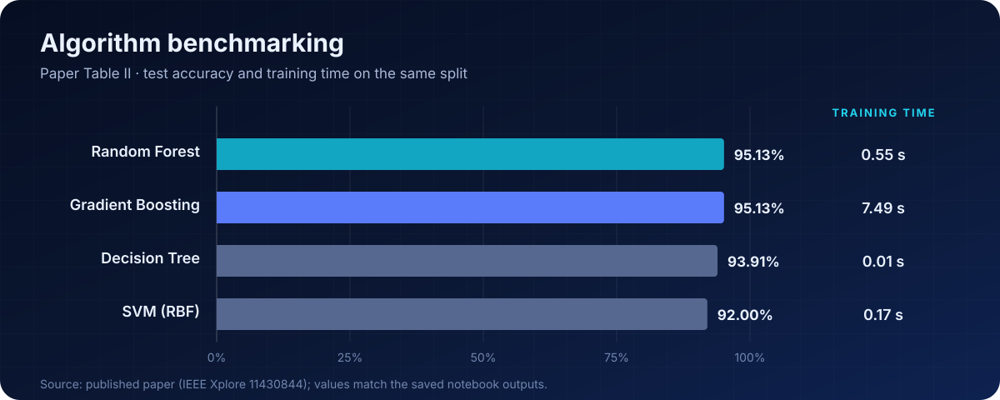
</p>

| Algorithm (paper Table II) | Accuracy | Training time |
|---|:---:|:---:|
| 🌲 **Random Forest** | **0.9513** | **0.55 s** |
| Gradient Boosting | 0.9513 | 7.49 s |
| Decision Tree | 0.9391 | 0.01 s |
| SVM (RBF) | 0.9200 | 0.17 s |

> Random Forest matches the top accuracy while training about **13× faster** than Gradient Boosting, which makes it a strong fit for edge devices.

---

## 📊 Scalability

<p align="center">
  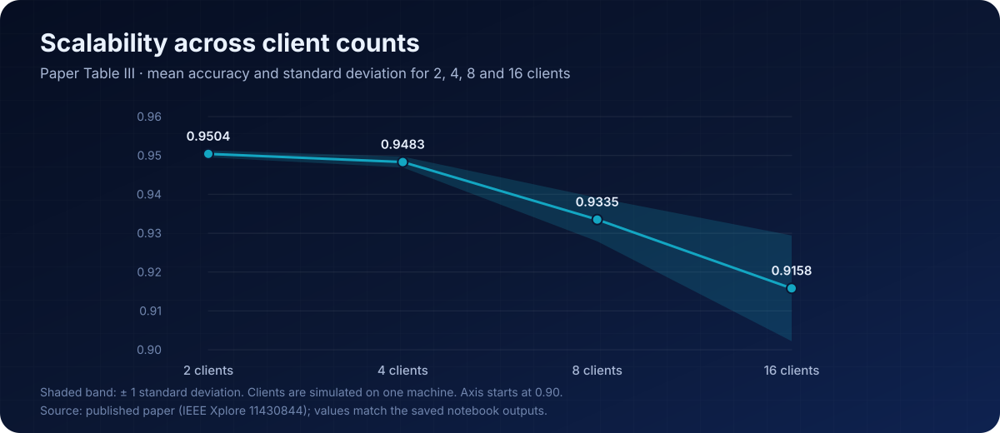
</p>

| Clients (paper Table III) | Mean accuracy | Std. dev. |
|:---:|:---:|:---:|
| 2 | 0.9504 | 0.0009 |
| 4 | 0.9483 | 0.0014 |
| 8 | 0.9335 | 0.0056 |
| 16 | 0.9158 | 0.0136 |

---

## 🧠 SHAP explainability

<p align="center">
  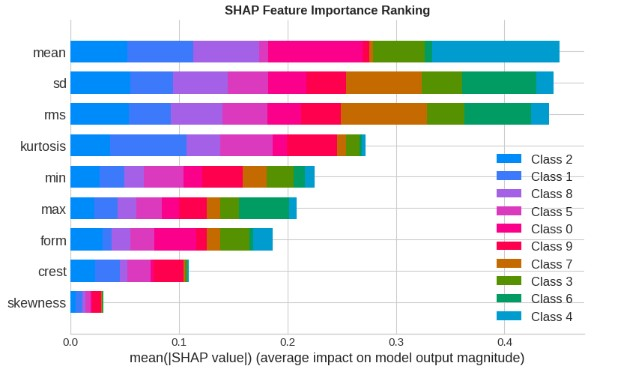
</p>

| Feature | Physical meaning |
|---|---|
| **RMS** | Vibration energy, which rises as bearing damage grows |
| **Standard deviation** | Variability caused by impact events |
| **Mean** | Shifts in the global signal level |
| **Kurtosis** | Impulsiveness typical of early-stage defects |
| **Minimum** | Sensitivity to baseline shifts and impulsive faults |

The most influential features are amplitude and energy statistics, which matches established vibration-based fault-diagnosis theory. In the figure, *mean*, *sd* and *rms* have nearly equal importance. Legend class indices follow alphabetical label encoding (Class 0 = Ball_007, Class 6 = Normal).

---

## 🚀 Getting started

**Option 1: Kaggle (recommended)**

1. Open `iiot-federated-pdm.ipynb` on [Kaggle](https://www.kaggle.com/).
2. Add the dataset [`brjapon/cwru-bearing-datasets`](https://www.kaggle.com/datasets/brjapon/cwru-bearing-datasets).
3. Run all cells.

The notebook saves figures, CSV metrics and the trained models to the working directory.

**Option 2: Local**

```bash
git clone https://github.com/Nahla-Nabil/Federated-PdM-IIoT.git
cd Federated-PdM-IIoT
pip install numpy pandas scipy scikit-learn shap matplotlib seaborn joblib jupyter
jupyter notebook iiot-federated-pdm.ipynb
```

<details>
<summary><b>Tips for local runs</b></summary>

- The data loader looks for the CSV under `/kaggle/input/...`. If the file is not found there, it generates a synthetic demo dataset instead. Check that the first output line reads `Loading: …feature_time_48k_2048_load_1.csv`.
- The notebook's plot style needs matplotlib ≥ 3.6.
- `federated_pdm_complete.py` stores the notebook in JSON format. Open it in Jupyter rather than running it with `python`.
- The paper used SHAP 0.41. With newer SHAP versions, the SHAP plotting cell may be skipped by its `try/except` block.

</details>

---

## 📁 Repository structure

```text
Federated-PdM-IIoT/
├── iiot-federated-pdm.ipynb      # Main experiment notebook
├── federated_pdm_complete.py     # Notebook copy (JSON format)
├── config.yaml                   # Experiment settings reference
├── requirements.txt              # Dependencies
├── RESULTS.md                    # Results summary
├── data/README.md                # Dataset notes
├── docs/
│   ├── ARCHITECTURE.md           # Architecture notes
│   ├── INSTALLATION.md           # Installation guide
│   └── assets/                   # README graphics (SVG) and their generator
├── results/figures/              # Figures from the notebook run
└── LICENSE
```

---

## 🛠 Technology stack

| Layer | Tools |
|---|---|
| Language | Python |
| Machine learning | scikit-learn (Random Forest, Gradient Boosting, Decision Tree, SVM) |
| Explainability | SHAP |
| Data | NumPy · pandas · SciPy |
| Visualization | Matplotlib · Seaborn |
| Environment | Jupyter / Kaggle Notebooks |

---

## ⚠ Limitations

- Clients are simulated partitions of one dataset on one machine. No physical edge hardware or network was used.
- One benchmark (CWRU) at a single load condition (1 hp).
- Single train/test split and a single aggregation round.
- No formal privacy analysis (e.g., secure aggregation or differential privacy). Federated learning reduces raw-data movement but is not by itself a privacy guarantee.
- No deployment in an operating industrial plant.

---

## 🔮 Roadmap and future research

An extension study is planned. It builds on this work in several directions:

| Direction | Goal |
|---|---|
| 🔁 **Aggregation for tree ensembles** | Multi-round training and aggregation methods designed for Random Forests |
| 🎲 **Evaluation protocol** | Repeated runs with fixed seeds; comparison of client-partitioning protocols |
| 🌐 **Non-IID-aware FL** | FedProx, SCAFFOLD and personalized federated learning |
| 🏭 **Real-world data** | Multi-site and multi-load industrial datasets |
| 🔌 **Edge hardware** | Deployment and measurement on industrial edge devices |
| 🔒 **Privacy** | Secure aggregation and differential privacy for tree models |
| 🎛 **Multi-modal sensing** | Fusion of vibration, temperature and acoustic data |

---

## 📚 Citation

<p align="center">
  <a href="https://ieeexplore.ieee.org/document/11430844">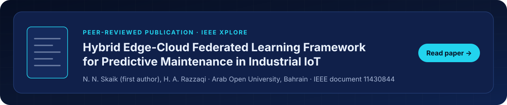</a>
</p>

If you use this work, please cite the published paper:

```bibtex
@inproceedings{skaik2025hybrid,
  title     = {Hybrid Edge-Cloud Federated Learning Framework for Predictive Maintenance in Industrial IoT},
  author    = {Skaik, Nahla Nabil and Razzaqi, Hasan Ali},
  publisher = {IEEE},
  year      = {2025},
  url       = {https://ieeexplore.ieee.org/document/11430844}
}
```

<sub>Authors as listed on the published paper. For the conference name, pages and DOI, use the “Cite This” option on IEEE Xplore.</sub>

---

## 👩‍💻 Author and contact

<p align="center">
  
</p>

<p align="center">
  <a href="https://www.linkedin.com/in/nahla-nabil-876597211/"></a>
  <a href="https://github.com/Nahla-Nabil"></a>
  <a href="mailto:nahla.nabil.52@gmail.com"></a>
</p>

<p align="center"><b>Nahla Nabil Skaik</b> · Arab Open University – Bahrain</p>

---

## 📜 License and data credits

- **Code:** [MIT License](LICENSE) © 2025 Nahla Nabil Skaik
- **Data:** Case Western Reserve University Bearing Data Center ([engineering.case.edu/bearingdatacenter](https://engineering.case.edu/bearingdatacenter)); feature table from Kaggle [`brjapon/cwru-bearing-datasets`](https://www.kaggle.com/datasets/brjapon/cwru-bearing-datasets) (CC BY-SA 4.0). The dataset is not redistributed in this repository.

<p align="center"><sub>⭐ If you find this project useful, please consider starring the repository.</sub></p>
